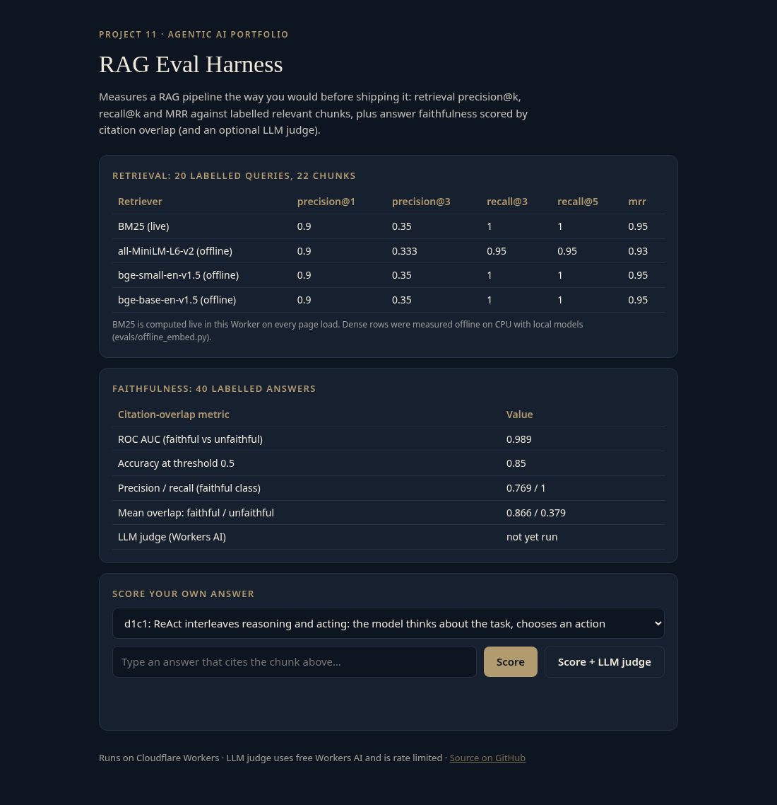

# agent-11-rag-eval-harness

An **evaluation harness for retrieval-augmented generation (RAG)**. It measures retrieval with precision@k, recall@k and MRR against hand-labelled relevant chunks, and measures answer faithfulness with a citation-overlap metric and an optional LLM judge. It runs on Cloudflare Workers on the free tier. Project 11 of the agentic AI portfolio.

**Live demo:** https://agent-11-rag-eval-harness.braylo777.workers.dev



## What it is
A RAG system can only be improved if you can measure it. This repo is a small, reusable harness:
- **Labelled set** (`src/data.js`, `evals/data.json`): 22 chunks (the agent-05 knowledge base split into sentences), 20 queries each labelled with its relevant chunk ids, and 40 labelled answers (20 faithful paraphrases and 20 answers with fabricated claims, each citing the gold chunk).
- **Retrieval metrics** (`src/metrics.js`): precision@k, recall@k and reciprocal rank, averaged per query. Any retriever plugs in by returning a ranked list of chunk ids per query (`scoreRetrieval`).
- **Faithfulness metric**: citation overlap is the share of an answer's content tokens (stopwords removed, light stemming) found in the chunks it cites. It is validated against the 40 labels with ROC AUC and accuracy at a fixed threshold of 0.5, which was chosen before scoring and not tuned.
- **LLM judge**: Llama 3.3 70B on Workers AI answers SUPPORTED or UNSUPPORTED for each answer against its cited sources.

## Architecture
```mermaid
flowchart LR
  L[(Labelled set<br/>22 chunks · 20 queries · 40 answers)] --> H[Harness<br/>src/harness.js]
  subgraph Retrievers
    B[BM25<br/>live in the Worker]
    E[MiniLM / BGE-small / BGE-base<br/>offline on CPU]
  end
  B -->|ranked chunk ids| H
  E -->|ranked chunk ids| H
  H --> M1[precision@k · recall@k · MRR]
  A[Answer + cited chunk ids] --> C[Citation overlap]
  A --> J[LLM judge<br/>Llama 3.3 70B · Workers AI]
  C --> M2[AUC · accuracy vs labels]
  J --> M2
  M1 --> R[evals/results.json + demo UI]
  M2 --> R
```

## Eval results
All numbers are measured. They come from `node evals/run.mjs` and `evals/offline_embed.py`, were run on Oct 27, 2026, and are recorded in [`evals/results.json`](evals/results.json).

**Retrieval** (20 queries; 19 have one relevant chunk and 1 has two, so precision@3 can reach at most about 0.35):

| Retriever | precision@1 | precision@3 | recall@3 | recall@5 | MRR |
|---|---|---|---|---|---|
| BM25 (k1=1.5, b=0.75), live in the Worker | 0.90 | 0.35 | 1.00 | 1.00 | 0.95 |
| all-MiniLM-L6-v2 (local CPU) | 0.90 | 0.333 | 0.95 | 0.95 | 0.93 |
| bge-small-en-v1.5 (local CPU) | 0.90 | 0.35 | 1.00 | 1.00 | 0.95 |
| bge-base-en-v1.5 (local CPU, same model as Workers AI `@cf/baai/bge-base-en-v1.5`) | 0.90 | 0.35 | 1.00 | 1.00 | 0.95 |

Mean query-embedding time on the box CPU: 5.6 ms for MiniLM, 4.0 ms for BGE-small and 9.0 ms for BGE-base. On a corpus this small, lexical BM25 matches the dense models. The set is too small to separate them, and growing it is the obvious next step.

**Faithfulness** (40 labelled answers):

| Metric | Citation overlap | LLM judge (Workers AI) |
|---|---|---|
| ROC AUC, faithful vs unfaithful | **0.989** | not yet run |
| Accuracy at threshold 0.5 | **0.85** (34/40) | not yet run |
| Precision / recall, faithful class | **0.769 / 1.00** | not yet run |
| Mean overlap, faithful / unfaithful | 0.866 / 0.379 | not applicable |

Known weakness: the 6 errors are all unfaithful answers that reuse many source words while changing a fact, such as "RAG keeps answers current by retraining the model every night". Token overlap cannot catch a negation or a swapped fact, which is why the LLM judge exists.

**Not yet run:** the LLM-judge column. The Workers AI free daily allocation was used up on Oct 27, 2026, and the live endpoint currently returns error `4006`. Rerun it after the daily reset:
```bash
BASE=https://agent-11-rag-eval-harness.braylo777.workers.dev node evals/judge.mjs   # 40 calls, ~9 min (5 req/min limit)
```

## Tests
12 offline unit tests (`node:test`, Workers AI mocked) cover:
- precision, recall and reciprocal-rank math and edge cases
- AUC with ties, tokenizing, and citation-overlap bounds
- BM25 ranking, and labelled-set integrity
- an oracle retriever scoring perfect, and deterministic results
- parsing the judge's replies, HTTP validation, and a judge failure being reported instead of crashing

```bash
npm test
```

## Run it
```bash
npm test                                   # unit tests (Node 20+)
node evals/run.mjs                         # BM25 + citation overlap, writes evals/results.json
pip install sentence-transformers && python evals/offline_embed.py   # dense retrievers on CPU
npx wrangler deploy                        # free tier
```

## API
- `GET /api/eval`: live BM25 metrics, citation-overlap metrics and the stored offline results
- `GET /api/data`: the labelled chunks and queries
- `POST /api/score` `{answer, cites:[chunkId]}`: citation overlap. Add `?judge=1` to also get the LLM judge's verdict (rate limited to 5 requests/min)

MIT licensed.
